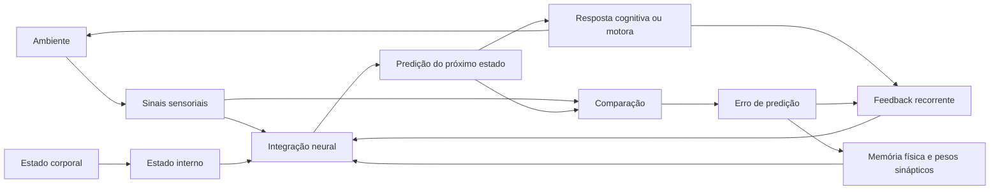

# Consciência como Loop Autopreditivo com Peso Sináptico

> **Uma hipótese neurocomputacional derivada de observações em conectomas simulados de _Drosophila melanogaster_**

<p align="center">
  <strong>Davi D'Artemis Sousa</strong><br>
  Pesquisador independente<br>
  Junho de 2026
</p>

<p align="center">
  
  
  
  
</p>

---

## Aviso científico

Este repositório apresenta uma **hipótese teórica e experimental em desenvolvimento**. Ele não demonstra a existência ou a ausência de consciência em insetos, recém-nascidos, sistemas artificiais ou conectomas simulados.

Os exemplos computacionais incluídos aqui são modelos conceituais simplificados. Eles servem para tornar a hipótese operacional e ajudar na elaboração de testes, não para reproduzir integralmente um cérebro biológico.

---

## Resumo

Este trabalho propõe que a consciência do eu pode ser compreendida como um **processo recorrente de autopredição**, sustentado por:

- memória física;
- pesos sinápticos;
- redes de engramas;
- modulação excitatória e inibitória;
- estados internos;
- integração sensorial;
- feedback neural recorrente.

A motivação inicial surgiu de observações em simulações conectômicas de _Drosophila melanogaster_. Nessas simulações, a injeção de ruído neural e a manipulação de estados internos produziram atividade e respostas motoras organizadas. Entretanto, essas respostas, por si mesmas, não permitem inferir consciência autobiográfica.

A hipótese central distingue quatro níveis:

1. **Vida**
2. **Reatividade neural**
3. **Proto-consciência**
4. **Consciência do eu**

A proposta é que a consciência autobiográfica emerge quando um sistema neural começa não apenas a reagir ao mundo, mas também a **reagir às próprias reações**, transformando continuamente sua saída em nova entrada e atualizando um modelo de si mesmo ao longo do tempo.

---

## Palavras-chave

`consciência` `proto-consciência` `conectoma` `Drosophila melanogaster` `memória` `engrama` `peso sináptico` `autopredição` `excitação/inibição` `mushroom body`

---

## Sumário

- [Visão geral](#visão-geral)
- [Problema de pesquisa](#problema-de-pesquisa)
- [Hipótese central](#hipótese-central)
- [Distinções conceituais](#distinções-conceituais)
- [Arquitetura proposta](#arquitetura-proposta)
- [Formulação computacional](#formulação-computacional)
- [Exemplo mínimo em Python](#exemplo-mínimo-em-python)
- [Condições experimentais](#condições-experimentais)
- [Métricas sugeridas](#métricas-sugeridas)
- [Predições testáveis](#predições-testáveis)
- [Drosophila e mushroom body](#drosophila-e-mushroom-body)
- [Recém-nascidos e gradação da consciência](#recém-nascidos-e-gradação-da-consciência)
- [Implicações](#implicações)
- [Limitações](#limitações)
- [Critérios de interpretação](#critérios-de-interpretação)
- [Estrutura sugerida do repositório](#estrutura-sugerida-do-repositório)
- [Como citar](#como-citar)
- [Referências](#referências)
- [Autor](#autor)

---

## Visão geral

A consciência permanece um problema central da neurociência, da ciência cognitiva, da inteligência artificial e da filosofia da mente. Definir vida não resolve automaticamente o problema da experiência subjetiva. Da mesma forma, observar atividade neural, respostas motoras ou comportamento organizado não prova a existência de um eu autobiográfico.

Este projeto adota uma posição gradual e operacional:

```text
vida
  ↓
reatividade neural
  ↓
integração sensório-interna
  ↓
proto-consciência
  ↓
recorrência estável + memória física + autopredição
  ↓
consciência do eu
```

Essa sequência não deve ser interpretada como uma escala universal já comprovada. Ela representa uma estrutura conceitual a ser testada.

---

## Problema de pesquisa

A pergunta principal é:

> **Quais propriedades adicionais distinguem um sistema meramente reativo de um sistema que mantém continuidade autopreditiva sobre si mesmo?**

Perguntas derivadas:

- Ruído neural é suficiente para sustentar organização temporal?
- Estados internos simulados produzem apenas modulação de comportamento ou também recorrência autônoma?
- Um circuito fechado entre percepção, memória, modulação e ação produz padrões diferentes de um circuito aberto?
- A continuidade do eu depende mais da intensidade de ativação ou da estabilidade recorrente?
- Pesos sinápticos funcionais melhoram a persistência e a correção de predições internas?
- A interrupção do feedback reduz a continuidade temporal do sistema?

---

## Hipótese central

> **A consciência do eu emerge quando um sistema neural com peso sináptico funcional suficiente utiliza memória física, modulação química, sinais internos e recorrência de circuito para prever e atualizar continuamente o próprio estado.**

Nessa formulação:

- a memória fornece o histórico;
- os pesos sinápticos preservam alterações produzidas pela experiência;
- a excitação e a inibição regulam estabilidade e ganho;
- os estados internos definem relevância biológica;
- os sensores fornecem informação externa e corporal;
- a saída altera o ambiente ou o próprio sistema;
- o feedback transforma essa consequência em uma nova entrada;
- o erro de predição atualiza o modelo e os pesos.

O eu não é tratado como um objeto armazenado em uma região isolada. Ele é tratado como uma **continuidade dinâmica**, reproduzida e atualizada a cada ciclo.

---

## Distinções conceituais

### 1. Vida

Sistema químico autossustentável capaz de manter organização interna, trocar energia com o ambiente e participar, em escala populacional, de processos evolutivos.

A vida é uma condição biológica. Ela não é equivalente, por definição, à experiência subjetiva.

### 2. Reatividade neural

Capacidade de converter estímulos internos ou externos em mudanças de estado, atividade neural ou resposta motora.

Exemplos:

- reflexos;
- orientação por estímulo visual;
- resposta a odores;
- alteração de comportamento por fome;
- ativação motora por circuitos sensoriais.

Reatividade organizada não é evidência suficiente de consciência autobiográfica.

### 3. Proto-consciência

Estado intermediário de integração sensorial e corporal no qual pode existir regulação interna, seleção de estímulos e possível experiência primária, mas sem evidência necessária de um eu autobiográfico estável.

O termo funciona como categoria de investigação, não como diagnóstico definitivo de experiência subjetiva.

### 4. Consciência do eu

Loop recorrente e estável capaz de:

- integrar sinais externos e internos;
- utilizar memória física;
- produzir previsões sobre o próprio estado;
- comparar previsão e estado atualizado;
- corrigir o modelo interno;
- preservar continuidade temporal.

### Comparação resumida

| Nível | Integração sensorial | Estado interno | Memória | Feedback recorrente | Eu autobiográfico |
|---|---:|---:|---:|---:|---:|
| Vida | não obrigatório | básico | não obrigatório | não obrigatório | não inferido |
| Reatividade | presente | possível | opcional | limitado | não inferido |
| Proto-consciência | integrada | relevante | curta ou funcional | parcial | não demonstrado |
| Consciência do eu | integrada | contextual | persistente | fechado e estável | hipótese positiva |

---

## Arquitetura proposta



### Componentes mínimos

1. **Entrada externa**: sinais visuais, químicos, mecânicos, térmicos ou auditivos.
2. **Entrada interna**: fome, sede, sono, dor, estresse e estado energético.
3. **Memória física**: pesos sinápticos, conectividade e engramas.
4. **Modelo preditivo**: transformação do estado atual em uma previsão.
5. **Saída**: alteração motora, cognitiva ou regulatória.
6. **Comparador**: cálculo da diferença entre previsão e observação.
7. **Plasticidade**: atualização dos pesos em função do erro.
8. **Recorrência**: reinserção da saída e de seus efeitos no sistema.

---

## Formulação computacional

Considere o estado integrado do sistema no instante `t`:

```math
x_t = f(s_t, i_t, r_{t-1}, W_t)
```

Onde:

- `s_t` representa sinais externos;
- `i_t` representa o estado interno;
- `r_(t-1)` representa feedback recorrente;
- `W_t` representa os pesos sinápticos e a memória física;
- `f` representa a dinâmica de integração.

A predição do próximo estado pode ser representada por:

```math
p_{t+1} = g(x_t, W_t)
```

O erro de predição:

```math
ε_t = o_{t+1} - p_{t+1}
```

A atualização dos pesos:

```math
W_{t+1} = W_t + η · h(ε_t, x_t, a_t)
```

Onde:

- `o_(t+1)` é o estado observado após a ação;
- `a_t` é a saída produzida;
- `η` é a taxa de aprendizagem;
- `h` é a regra de plasticidade.

A recorrência é expressa como:

```math
r_t = q(a_t, o_{t+1}, ε_t)
```

### Pseudocódigo conceitual

```python
estado_interno = ruido_basal + modulacao_neuroquimica
memoria_fisica = pesos_sinapticos + redes_de_engrama
feedback_recorrente = estado_inicial

while sistema_integrado:
    entrada = (
        sinais_externos
        + sinais_internos
        + feedback_recorrente
    )

    predicao = modelo_do_sistema(
        entrada=entrada,
        memoria=memoria_fisica,
        estado_interno=estado_interno,
    )

    saida = gerar_resposta(predicao)
    entrada_atualizada = observar_consequencias(saida)
    erro = comparar(predicao, entrada_atualizada)

    memoria_fisica = atualizar_pesos(
        memoria=memoria_fisica,
        erro=erro,
        saida=saida,
    )

    feedback_recorrente = transformar_em_feedback(
        saida=saida,
        observacao=entrada_atualizada,
        erro=erro,
    )
```

---

## Exemplo mínimo em Python

O exemplo abaixo não simula consciência. Ele ilustra a diferença entre entrada externa, estado interno, memória ponderada e feedback recorrente.

```python
from dataclasses import dataclass
import numpy as np


@dataclass
class EstadoInterno:
    fome: float = 0.0
    excitacao: float = 0.5
    inibicao: float = 0.5


class LoopAutopreditivo:
    def __init__(self, dimensao: int, taxa_aprendizado: float = 0.01):
        self.dimensao = dimensao
        self.eta = taxa_aprendizado
        self.pesos = np.eye(dimensao) * 0.1
        self.feedback = np.zeros(dimensao)
        self.estado = np.zeros(dimensao)

    def integrar(
        self,
        sinais_externos: np.ndarray,
        sinais_internos: np.ndarray,
    ) -> np.ndarray:
        entrada = sinais_externos + sinais_internos + self.feedback
        self.estado = np.tanh(self.pesos @ entrada)
        return self.estado

    def prever(self) -> np.ndarray:
        return np.tanh(self.pesos @ self.estado)

    def agir(self, predicao: np.ndarray) -> np.ndarray:
        return np.tanh(predicao)

    def atualizar(
        self,
        predicao: np.ndarray,
        observacao: np.ndarray,
    ) -> float:
        erro = observacao - predicao
        self.pesos += self.eta * np.outer(erro, self.estado)
        self.feedback = 0.8 * self.feedback + 0.2 * observacao
        return float(np.mean(erro ** 2))


def executar_ciclo(
    modelo: LoopAutopreditivo,
    sinal_externo: np.ndarray,
    sinal_interno: np.ndarray,
) -> dict:
    estado = modelo.integrar(sinal_externo, sinal_interno)
    predicao = modelo.prever()
    acao = modelo.agir(predicao)

    # Modelo simplificado da consequência da ação.
    observacao = 0.7 * sinal_externo + 0.3 * acao
    erro_quadratico = modelo.atualizar(predicao, observacao)

    return {
        "estado": estado,
        "predicao": predicao,
        "acao": acao,
        "observacao": observacao,
        "erro_quadratico": erro_quadratico,
    }


if __name__ == "__main__":
    rng = np.random.default_rng(seed=42)
    modelo = LoopAutopreditivo(dimensao=8)

    for ciclo in range(100):
        externo = rng.normal(0.0, 0.05, size=8)
        interno = np.zeros(8)
        interno[0] = 0.6  # Sinal interno abstrato, como fome.

        resultado = executar_ciclo(modelo, externo, interno)

        if ciclo % 10 == 0:
            erro = resultado["erro_quadratico"]
            print(f"ciclo={ciclo:03d} erro={erro:.6f}")
```

### Dependência do exemplo

```bash
python -m pip install numpy
```

### Execução

```bash
python exemplo_loop.py
```

### Interpretação correta

Uma redução do erro ou o aparecimento de recorrência estável nesse modelo indicaria apenas que o sistema aprendeu regularidades internas. Não seria, isoladamente, evidência de experiência subjetiva.

---

## Condições experimentais

### Condição A: ruído neural simples

Aplicar ruído basal de baixa frequência sem estímulos externos relevantes e sem feedback fechado.

```python
entrada = ruido_basal
feedback = np.zeros_like(entrada)
plasticidade = False
```

**Medir:**

- propagação;
- entropia;
- persistência;
- distribuição de disparos;
- padrões motores;
- autocorrelação temporal.

**Predição:** aumento de atividade sem organização autopreditiva sustentada.

### Condição B: ruído com estado interno

Adicionar um modulador interno artificial, como fome ou alteração do equilíbrio excitatório/inibitório.

```python
entrada = ruido_basal + ganho_fome * sinal_associado_a_alimento
feedback = np.zeros_like(entrada)
plasticidade = False
```

**Medir:**

- ganho de resposta;
- alteração de limiar;
- seleção de estímulos;
- coerência motora;
- dependência do modulador.

**Predição:** comportamento mais direcionado, ainda explicável por modulação reativa.

### Condição C: loop autopreditivo fechado

Fechar um circuito entre regiões sensoriais, área associativa ou de memória, circuitos moduladores e saída motora.

```python
entrada = sinais_externos + sinais_internos + feedback_anterior
predicao = modelo(entrada, pesos)
saida = politica(predicao)
erro = observacao - predicao
pesos = atualizar(pesos, erro)
feedback_anterior = transformar(saida, observacao, erro)
```

**Medir:**

- estabilidade temporal;
- recorrência;
- autocorrelação;
- robustez a perturbações;
- persistência sem estímulo externo;
- atualização de pesos;
- recuperação após interrupção do feedback.

**Predição:** padrões mais estáveis e autocorrelacionados do que nas condições A e B, desde que a recorrência permaneça regulada.

---

## Métricas sugeridas

### 1. Autocorrelação temporal

Avalia quanto o estado atual preserva estrutura de estados anteriores.

```python
import numpy as np


def autocorrelacao(serie: np.ndarray, atraso: int = 1) -> float:
    x = serie[:-atraso]
    y = serie[atraso:]
    if x.size == 0 or np.std(x) == 0 or np.std(y) == 0:
        return 0.0
    return float(np.corrcoef(x, y)[0, 1])
```

### 2. Erro médio de predição

```python
def erro_medio_quadratico(predito, observado):
    predito = np.asarray(predito)
    observado = np.asarray(observado)
    return float(np.mean((observado - predito) ** 2))
```

### 3. Persistência sem estímulo

Número de passos em que um padrão permanece detectável depois da remoção da entrada externa.

```python
def persistencia(estados, limiar=0.1):
    energia = np.linalg.norm(estados, axis=1)
    return int(np.sum(energia > limiar))
```

### 4. Sensibilidade a perturbações

Comparar a trajetória de uma execução de controle com outra que recebeu uma perturbação pequena.

```math
D(t) = ||x_t^(controle) - x_t^(perturbado)||₂
```

### 5. Índice de recorrência operacional

Uma métrica experimental simples pode combinar:

```math
R = αA + βP + γC - δE
```

Onde:

- `A` é autocorrelação;
- `P` é persistência;
- `C` é capacidade de recuperação;
- `E` é erro de predição;
- `α`, `β`, `γ` e `δ` são coeficientes definidos antes do experimento.

Esse índice não deve ser chamado de “medida de consciência”. Ele representa somente uma medida operacional de recorrência e estabilidade.

---

## Predições testáveis

A hipótese produz as seguintes previsões:

1. Ruído neural simples aumentará atividade, mas não necessariamente estabilidade temporal.
2. Estados internos simulados alterarão ganho, limiar e seleção de respostas.
3. Comportamento coerente poderá surgir sem um loop autopreditivo completo.
4. Loops fechados produzirão maior recorrência do que ruído difuso, quando adequadamente regulados.
5. A interrupção do feedback reduzirá a continuidade temporal e a capacidade de autocorreção.
6. O aumento gradual de peso sináptico funcional melhorará a retenção de regularidades.
7. Recorrência excessiva e mal regulada poderá produzir instabilidade, saturação ou dinâmica convulsiva.
8. A estabilidade dependerá do equilíbrio entre excitação, inibição, plasticidade e dissipação.
9. Sistemas com memória semelhante, mas históricos físicos separados, formarão trajetórias recorrentes distintas.
10. A continuidade autobiográfica, se associada ao modelo, deverá correlacionar-se mais com recorrência integrada do que com intensidade bruta de ativação.

---

## Drosophila e mushroom body

A _Drosophila melanogaster_ é um modelo útil porque seu conectoma permite investigar trajetórias entre:

- sistemas sensoriais;
- circuitos associativos;
- vias de memória;
- neurônios moduladores;
- circuitos motores.

O **mushroom body** é especialmente relevante devido à sua associação com aprendizagem, memória, integração sensorial e modulação por contexto fisiológico.

Entretanto, um conectoma anatômico não contém sozinho toda a dinâmica do organismo. Uma simulação biologicamente mais informativa deveria incorporar, na medida do possível:

- sinais e polaridade sináptica;
- atrasos de propagação;
- plasticidade;
- neuromodulação;
- metabolismo;
- interação corpo-ambiente;
- células gliais;
- ruído estruturado;
- mecanismos homeostáticos.

---

## Recém-nascidos e gradação da consciência

A aplicação da hipótese a recém-nascidos exige cautela. O modelo não afirma que recém-nascidos sejam inconscientes.

A distinção proposta é mais limitada:

- respostas sensoriais não demonstram sozinhas um eu autobiográfico;
- reflexos não esgotam a possibilidade de experiência inicial;
- integração corporal e perceptiva pode sustentar formas iniciais de experiência;
- memória, densidade funcional e recorrência desenvolvem-se gradualmente;
- consciência perceptiva e consciência autobiográfica não precisam surgir simultaneamente.

O desenvolvimento pode ser investigado como uma transição gradual entre integração inicial, memória funcional, recorrência estável e autopredição de maior alcance temporal.

---

## Implicações

### Para a neurociência computacional

A hipótese sugere que experimentos devem comparar explicitamente circuitos abertos e fechados, em vez de medir apenas intensidade de atividade.

### Para conectomas artificiais

Um conectoma estrutural pode gerar propagação sem reproduzir plasticidade, corpo, química ou história individual. A recorrência deve ser avaliada como propriedade dinâmica, não presumida a partir da anatomia.

### Para inteligência artificial

Sistemas que mantêm memória, predição e feedback podem apresentar propriedades de autorregulação. Essas propriedades não autorizam, por si mesmas, atribuição de experiência subjetiva.

### Para identidade e continuidade

Duas cópias inicialmente idênticas, contendo as mesmas memórias, passam a constituir processos distintos quando seus loops físicos seguem trajetórias separadas. A identidade estaria relacionada não apenas ao conteúdo, mas à continuidade do processo recorrente.

### Para metodologia científica

O projeto favorece métricas observáveis e hipóteses refutáveis, sem supor que uma única métrica resolva o problema fenomenológico da consciência.

---

## Limitações

1. A hipótese não resolve o problema da experiência subjetiva.
2. Correlação entre recorrência e comportamento não demonstra fenomenologia.
3. Conectomas anatômicos não reproduzem integralmente a dinâmica biológica.
4. O modelo ainda não estabelece um limiar objetivo de “peso sináptico suficiente”.
5. Proto-consciência é uma categoria operacional, não uma entidade diretamente mensurável.
6. Métricas de estabilidade também podem aparecer em sistemas não conscientes.
7. A recorrência isolada pode gerar ciclos triviais, saturação ou instabilidade.
8. O papel do corpo e do ambiente precisa ser explicitamente modelado.
9. Comparações entre insetos, humanos e sistemas artificiais exigem critérios diferentes.
10. Resultados negativos em uma implementação não refutam toda a classe de modelos sem controle de arquitetura e parâmetros.

---

## Critérios de interpretação

### O que contaria como suporte parcial

- maior estabilidade na condição de loop fechado;
- redução consistente do erro de predição;
- persistência regulada depois da remoção do estímulo;
- recuperação após perturbações moderadas;
- dependência demonstrável da memória física;
- degradação seletiva após interrupção do feedback.

### O que não deve ser interpretado como prova de consciência

- movimento organizado;
- resposta a estímulos;
- redução do erro em uma rede;
- presença de memória;
- alta conectividade;
- recorrência simples;
- complexidade visual de padrões;
- antropomorfização do comportamento.

### Possíveis resultados que enfraqueceriam a hipótese

- ausência de diferenças robustas entre as três condições;
- recorrência estável sem qualquer dependência dos pesos;
- desempenho igual ou superior em modelos puramente reativos;
- interrupção do feedback sem efeito mensurável;
- métricas escolhidas incapazes de separar ciclos triviais de autopredição funcional.

---

## Estrutura sugerida do repositório

```text
.
├── README.md
├── LICENSE
├── CITATION.cff
├── artigo/
│   └── artigo_original.docx
├── docs/
│   ├── protocolo_experimental.md
│   ├── definicoes.md
│   └── limitacoes.md
├── src/
│   ├── modelo.py
│   ├── metricas.py
│   └── experimentos.py
├── tests/
│   ├── test_modelo.py
│   └── test_metricas.py
├── notebooks/
│   └── exploracao.ipynb
├── data/
│   └── README.md
├── results/
│   └── README.md
└── requirements.txt
```

### Exemplo de `requirements.txt`

```text
numpy
scipy
pandas
matplotlib
networkx
```

> Fixe versões antes de publicar resultados reprodutíveis.

### Boas práticas recomendadas

- conservar parâmetros e sementes aleatórias;
- separar dados brutos de dados processados;
- registrar a versão do conectoma;
- documentar critérios de inclusão e exclusão;
- publicar resultados negativos;
- evitar alterar métricas depois de observar resultados;
- incluir testes de controle e ablação;
- distinguir observações, interpretações e especulações.

---

## Roteiro de desenvolvimento

- [x] Formular a hipótese central.
- [x] Distinguir vida, reatividade, proto-consciência e consciência do eu.
- [x] Propor três condições experimentais.
- [x] Definir métricas iniciais.
- [ ] Formalizar o modelo matemático completo.
- [ ] Implementar condição A.
- [ ] Implementar condição B.
- [ ] Implementar condição C.
- [ ] Criar testes de ablação do feedback.
- [ ] Avaliar diferentes regras de plasticidade.
- [ ] Medir estabilidade em múltiplas sementes.
- [ ] Definir critérios estatísticos antes da análise.
- [ ] Publicar código, parâmetros e resultados.
- [ ] Submeter o manuscrito à revisão por pares.

---

## Como citar

### Citação sugerida

```text
Sousa, D. D'A. (2026). Consciência como Loop Autopreditivo com Peso
Sináptico: uma hipótese neurocomputacional derivada de observações em
conectomas simulados de Drosophila melanogaster. Repositório GitHub.
```

### BibTeX

```bibtex
@misc{sousa2026loopautopreditivo,
  author       = {Davi D'Artemis Sousa},
  title        = {Consciência como Loop Autopreditivo com Peso Sináptico},
  year         = {2026},
  howpublished = {Repositório GitHub},
  note         = {Hipótese neurocomputacional em desenvolvimento}
}
```

---

## Referências

1. Benner, S. A. (2010). Defining life. *Astrobiology, 10*(10), 1021-1030. https://doi.org/10.1089/ast.2010.0524
2. Tononi, G. (2004). An information integration theory of consciousness. *BMC Neuroscience, 5*, 42. https://doi.org/10.1186/1471-2202-5-42
3. Tononi, G. (2008). Consciousness as integrated information: A provisional manifesto. *The Biological Bulletin, 215*(3), 216-242. https://doi.org/10.2307/25470707
4. Dehaene, S., & Changeux, J.-P. (2011). Experimental and theoretical approaches to conscious processing. *Neuron, 70*(2), 200-227. https://doi.org/10.1016/j.neuron.2011.03.018
5. Chalmers, D. J. (1995). Facing up to the problem of consciousness. *Journal of Consciousness Studies, 2*(3), 200-219.
6. Bayne, T., Frohlich, J., Cusack, R., Moser, J., & Naci, L. (2023). Consciousness in the cradle: On the emergence of infant experience. *Trends in Cognitive Sciences, 27*(12), 1135-1149.
7. Hu, H., Cusack, R., & Naci, L. (2022). Typical and disrupted brain circuitry for conscious awareness in full-term and preterm infants. *Brain Communications, 4*(2), fcac071. https://doi.org/10.1093/braincomms/fcac071
8. Lagercrantz, H. (2025). The awakening of the newborn human infant and the emergence of consciousness. *Acta Paediatrica, 114*(5), 823-828.
9. Rao-Ruiz, P., Visser, E., Mitrić, M., Smit, A. B., & van den Oever, M. C. (2021). A synaptic framework for the persistence of memory engrams. *Frontiers in Synaptic Neuroscience, 13*, 661476. https://doi.org/10.3389/fnsyn.2021.661476
10. Zaki, Y., & Cai, D. J. (2024). Memory engram stability and flexibility. *Neuropsychopharmacology, 50*, 285-293. https://doi.org/10.1038/s41386-024-01979-z
11. Li, F., Lindsey, J. W., Marin, E. C., Otto, N., Dreher, M., Dempsey, G., et al. (2020/2021). The connectome of the adult Drosophila mushroom body provides insights into function. *eLife, 9*, e62576. https://doi.org/10.7554/eLife.62576
12. Suárez-Grimalt, R., Grunwald Kadow, I. C., & Scheunemann, L. (2024). An integrative sensor of body states: How the mushroom body modulates behavior depending on physiological context. *Learning & Memory, 31*(5), a053918. https://doi.org/10.1101/lm.053918.124
13. Pal, M. M. (2021). Glutamate: The master neurotransmitter and its implications in chronic stress and mood disorders. *Frontiers in Human Neuroscience, 15*, 722323. https://doi.org/10.3389/fnhum.2021.722323
14. Tsuboi, D., Nagai, T., Yoshimoto, J., & Kaibuchi, K. (2024). Neuromodulator regulation and emotions: Insights from the crosstalk of cell signaling. *Frontiers in Molecular Neuroscience, 17*, 1376762. https://doi.org/10.3389/fnmol.2024.1376762

---

## Uso responsável

Ao discutir possíveis formas de consciência em animais, recém-nascidos ou sistemas artificiais:

- evite conclusões categóricas baseadas somente em comportamento;
- diferencie simulação funcional de evidência fenomenológica;
- declare as limitações dos dados;
- preserve o caráter testável da hipótese;
- não utilize o modelo como base isolada para decisões clínicas, éticas ou jurídicas.

---

## Contribuições

Contribuições científicas e técnicas são bem-vindas, especialmente nas áreas de:

- modelagem de redes recorrentes;
- análise de conectomas;
- métricas de estabilidade temporal;
- plasticidade sináptica;
- desenho experimental;
- reprodução de resultados;
- filosofia da mente;
- revisão bibliográfica.

Ao propor alterações, diferencie claramente:

1. correções factuais;
2. extensões matemáticas;
3. resultados experimentais;
4. interpretações filosóficas;
5. especulações.

---

## Autor

**Davi D'Artemis Sousa**  
Pesquisador independente

---

## Nota final

A tese deste projeto pode ser condensada em uma frase:

> **Memória fornece continuidade histórica, modulação fornece relevância, recorrência fornece continuidade dinâmica e autopredição transforma a reação do sistema em um modelo continuamente atualizado de si mesmo.**

A presença dessas propriedades ainda não resolve, sozinha, o problema da experiência subjetiva. A contribuição pretendida é oferecer uma estrutura operacional para testar diferenças entre atividade, reatividade, integração, memória e autopredição recorrente.
